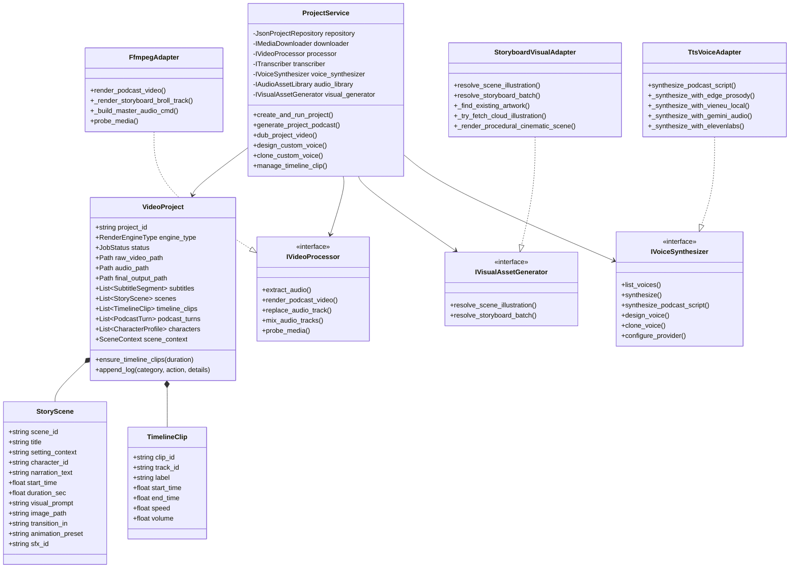
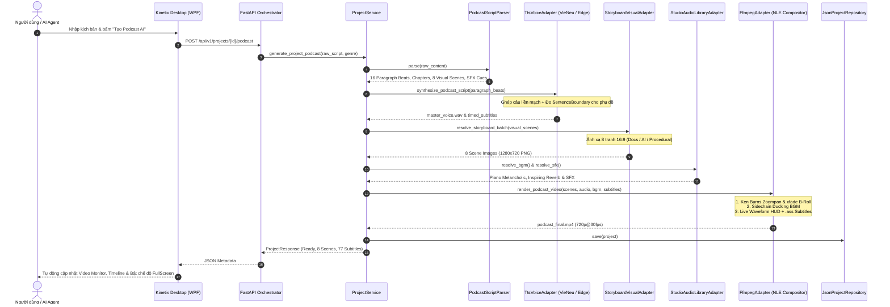

# KinetixAI (FlowVids-AI) — Complete Architectural Code Graph

> **Kiến trúc Tổng thể Hệ sinh thái KinetixAI (FlowVids-AI) v6.1**  
> Tuân thủ nghiêm ngặt **Clean Architecture** (Domain -> Application -> Infrastructure -> Presentation) & **Nguyên lý Đảo ngược Phụ thuộc (DIP)**.

---

## 1. Bản Đồ Phân Tầng Clean Architecture (Layer Dependency Topology)

Sơ đồ thể hiện chiều phụ thuộc: Các tầng ngoài luôn phụ thuộc vào các tầng bên trong; **Domain Layer** là hạt nhân độc lập, không phụ thuộc bất kỳ thư viện bên ngoài hay tầng nào khác.

```mermaid
flowchart TD
    subgraph PresentationLayer["4. PRESENTATION LAYER (Giao diện & Cổng giao tiếp)"]
        WPF["desktop_app/KinetixAI.Desktop<br/>(C# WPF Native NLE & Cinema FullScreen)"]
        FastAPI["src/presentation/api/main.py<br/>(REST API Server)"]
        MCPServer["src/presentation/mcp/mcp_server.py<br/>(Antigravity MCP Server - 27 Tools)"]
        CLI["src/presentation/cli/main.py<br/>(Command Line Interface)"]
        Schemas["src/presentation/schemas/project_schemas.py<br/>(Pydantic Data Contracts)"]
    end

    subgraph ApplicationLayer["3. APPLICATION LAYER (Use Cases & Điều phối luồng)"]
        ProjectService["src/application/services/project_service.py<br/>(ProjectService - Use Cases Aggregate)"]
        AutoPipeline["src/application/pipelines/auto_video_pipeline.py<br/>(AutoVideoPipeline - 5-Step Ingestion)"]
        RendererFactory["src/application/factories/renderer_factory.py<br/>(RendererFactory - Remotion vs HyperFrames)"]
    end

    subgraph InfrastructureLayer["2. INFRASTRUCTURE LAYER (Adapters & Công cụ thứ ba)"]
        FfmpegAdapter["src/infrastructure/processors/ffmpeg_adapter.py<br/>(FFmpeg NLE, Ken Burns, Sidechain Ducking, HUD)"]
        StoryboardAdapter["src/infrastructure/visuals/storyboard_visual_adapter.py<br/>(16:9 AI Storyboard, Pollinations, Pillow Cinema)"]
        TtsAdapter["src/infrastructure/tts/tts_voice_adapter.py<br/>(Edge-TTS, VieNeu Local ONNX, Gemini Acting, ElevenLabs)"]
        AudioAdapter["src/infrastructure/audio/audio_library_adapter.py<br/>(Felt Piano Reverb, Diegetic SFX)"]
        WhisperAdapter["src/infrastructure/transcribers/whisper_adapter.py<br/>(Faster-Whisper Subtitle Alignment)"]
        YtDlpAdapter["src/infrastructure/downloaders/ytdlp_adapter.py<br/>(yt-dlp Media Ingestion)"]
        RemotionAdapter["src/infrastructure/renderers/remotion_adapter.py<br/>(Node.js Remotion React Runner)"]
        HyperFramesAdapter["src/infrastructure/renderers/hyperframes_adapter.py<br/>(Node.js HyperFrames GSAP Runner)"]
        JsonRepo["src/infrastructure/repositories/json_project_repository.py<br/>(Hot-Reloading JSON State Store)"]
    end

    subgraph DomainLayer["1. DOMAIN LAYER (Hạt nhân nghiệp vụ thuần túy - Pure Core)"]
        subgraph DomainEntities["Domain Entities & Aggregates"]
            VideoProject["VideoProject (Aggregate Root)"]
            StoryScene["StoryScene (Storyboard Scenes)"]
            TimelineClip["TimelineClip (Multi-Track NLE Clips)"]
            VoiceProfile["VoiceProfile (VoiceStudio Profiles)"]
            PodcastTurn["PodcastTurn (Dialogue & Story Beats)"]
            SubtitleSegment["SubtitleSegment & WordTimestamp"]
            SceneContext["SceneContext (World & Visual Bible)"]
            CharacterProfile["CharacterProfile (Consistent Characters)"]
            AuditLogEntry["AuditLogEntry (Timeline Audit Ledger)"]
            Enums["Enums (JobStatus, Genre, Transitions, AspectRatio)"]
        end

        subgraph DomainServices["Domain Services"]
            ScriptParser["PodcastScriptParser<br/>(16 Paragraph Beats & Visual Scene Specs)"]
        end

        subgraph DomainInterfaces["DIP Interface Contracts (abc.ABC)"]
            IVideoProcessor["IVideoProcessor"]
            IVisualAssetGenerator["IVisualAssetGenerator"]
            IVoiceSynthesizer["IVoiceSynthesizer"]
            IAudioAssetLibrary["IAudioAssetLibrary"]
            ITranscriber["ITranscriber"]
            IMediaDownloader["IMediaDownloader"]
            IVisualRenderer["IVisualRenderer"]
        end
    end

    %% Presentation -> Application
    WPF -->|"HTTP/JSON API Calls"| FastAPI
    Schemas -->|"Validates DTOs"| FastAPI
    FastAPI --> ProjectService
    MCPServer --> ProjectService
    CLI --> ProjectService

    %% Application -> Domain Interfaces
    ProjectService -->|"Depends on DIP"| IVideoProcessor
    ProjectService -->|"Depends on DIP"| IVisualAssetGenerator
    ProjectService -->|"Depends on DIP"| IVoiceSynthesizer
    ProjectService -->|"Depends on DIP"| IAudioAssetLibrary
    ProjectService -->|"Uses Domain Service"| ScriptParser
    ProjectService -->|"Uses Entity"| VideoProject
    AutoPipeline -->|"Depends on DIP"| IMediaDownloader
    AutoPipeline -->|"Depends on DIP"| ITranscriber
    AutoPipeline -->|"Depends on DIP"| IVisualRenderer
    RendererFactory -->|"Resolves"| IVisualRenderer

    %% Infrastructure -> Domain Interfaces (Implementation)
    FfmpegAdapter -.->|"Implements"| IVideoProcessor
    StoryboardAdapter -.->|"Implements"| IVisualAssetGenerator
    TtsAdapter -.->|"Implements"| IVoiceSynthesizer
    AudioAdapter -.->|"Implements"| IAudioAssetLibrary
    WhisperAdapter -.->|"Implements"| ITranscriber
    YtDlpAdapter -.->|"Implements"| IMediaDownloader
    RemotionAdapter -.->|"Implements"| IVisualRenderer
    HyperFramesAdapter -.->|"Implements"| IVisualRenderer
    JsonRepo -.->|"Persists"| VideoProject
```



---

## 2. Bản Đồ Mối Quan Hệ Giữa Các Module & Các File Mã Nguồn



---

## 3. Luồng Xử Lý Dữ Liệu Tự Động (Data Pipeline & Production Flow)



---

## 4. Cấu Trúc File & Module Trong Toàn Bộ Repository

```text
D:\AI_Learning_Repository\KinetixAI\
├── src/                                  # Mã nguồn chính (Python 3.11 Clean Architecture)
│   ├── domain/                           # 1. Hạt nhân Domain (Thực thể & Giao diện DIP)
│   │   ├── entities/                     # VideoProject, StoryScene, TimelineClip, VoiceProfile
│   │   ├── interfaces/                   # IVideoProcessor, IVisualAssetGenerator, IVoiceSynthesizer, ...
│   │   └── services/                     # PodcastScriptParser (Tách beat cảm xúc & cảnh visual)
│   ├── application/                      # 2. Tầng Application (Use Cases & Điều phối)
│   │   ├── factories/                    # RendererFactory
│   │   ├── pipelines/                    # AutoVideoPipeline (Quy trình 5 bước tự động)
│   │   └── services/                     # ProjectService (Toàn bộ logic nghiệp vụ Studio)
│   ├── infrastructure/                   # 3. Tầng Infrastructure (Adapters bên ngoài)
│   │   ├── audio/                        # StudioAudioLibraryAdapter (Felt Piano, Diegetic SFX)
│   │   ├── downloaders/                  # YtDlpAdapter (yt-dlp)
│   │   ├── processors/                   # FfmpegAdapter (FFmpeg NLE, Ken Burns, Sidechain)
│   │   ├── renderers/                    # RemotionAdapter & HyperFramesAdapter
│   │   ├── repositories/                 # JsonProjectRepository (State store hot-reload)
│   │   ├── transcribers/                 # WhisperAdapter (Faster-Whisper)
│   │   ├── tts/                          # TtsVoiceAdapter (Edge-TTS, VieNeu-TTS, Gemini, ElevenLabs)
│   │   └── visuals/                      # StoryboardVisualAdapter (16:9 AI Scene Illustrations)
│   └── presentation/                     # 4. Tầng Presentation (Cổng kết nối)
│       ├── api/                          # FastAPI REST API (`main.py`)
│       ├── cli/                          # CLI commands (`main.py`)
│       ├── mcp/                          # Antigravity MCP Server (`mcp_server.py` - 27 tools)
│       └── schemas/                      # Pydantic Schemas (`project_schemas.py`)
│
├── desktop_app/                          # Native Windows C# .NET 10 WPF Desktop NLE Client
│   └── KinetixAI.Desktop/
│       ├── MainWindow.xaml / .cs         # Giao diện chính: Program Monitor, 5-Track Timeline, 6 Studio Tabs
│       ├── FullScreenPlayerWindow.xaml/.cs# Rạp chiếu toàn màn hình 1:1, Auto-Hiding Glass HUD
│       └── Models/ApiModels.cs           # C# DTOs ánh xạ 1:1 với Pydantic Schemas
│
├── render_engines/                       # Visual Motion Graphics Engines (Node.js 20+)
│   ├── remotion_engine/                  # Remotion React Engine (Canvas / WebGL / Fonts)
│   └── hyperframes_engine/               # HyperFrames HTML5 / GSAP / Canvas Engine
│
├── docs/                                 # Tài liệu kỹ thuật & Tài nguyên dự án
│   ├── CODE_GRAPH.md                     # Tài liệu Code Graph toàn diện
│   ├── code_graph_interactive.html       # Bản đồ Code Graph tương tác trực quan (Mở trên trình duyệt)
│   ├── storyboard_tap_01/                # 8 tranh AI Cinematic Storyboard 16:9 hoàn chỉnh
│   └── Tai_lieu_huong_dan_su_dung_*.docx # Sách Hướng dẫn Sử dụng Doanh nghiệp
│
└── specs/                                # GitHub Spec Kit Specification & Implementation Plans
    └── 001-auto-video-desktop-system/
        ├── spec.md                       # Feature Specifications (US1 - US14)
        ├── plan.md                       # Implementation Plans
        ├── tasks.md                      # Task Tracking (T001 - T096)
        ├── research.md                   # Technical Research & Decisions
        ├── data-model.md                 # Data Models & Entities
        ├── contracts/                    # API & IPC Contracts
        └── quickstart.md                 # Quickstart Validation Guide
```

---

## 5. Danh Mục Công Cụ Antigravity MCP Server (27 MCP Tools)

Phần mềm cung cấp 27 MCP tools sẵn sàng để AI Agent gọi trực tiếp:

1. **Pipeline & Quản lý Video**: `kinetix_health_check`, `kinetix_inspect_source`, `kinetix_produce_video`, `kinetix_list_projects`, `kinetix_get_project`, `kinetix_clone_project`, `kinetix_delete_project`, `kinetix_probe_media`.
2. **NLE Biên tập & Hiệu ứng**: `kinetix_trim_video`, `kinetix_change_speed`, `kinetix_apply_color_grade`, `kinetix_reframe_video`, `kinetix_master_audio`, `kinetix_capture_snapshot`, `kinetix_apply_beat_cut`, `kinetix_apply_transition_animation`, `kinetix_manage_timeline_clip`.
3. **Phân cảnh & Nhân vật**: `kinetix_manage_character`, `kinetix_manage_scene`.
4. **Âm thanh & VoiceStudio**: `kinetix_generate_voiceover`, `kinetix_apply_sound_library`, `kinetix_produce_podcast`, `kinetix_design_voice`, `kinetix_clone_voice`, `kinetix_dub_video`.
5. **Phụ đề & Desktop App**: `kinetix_update_subtitles`, `kinetix_launch_desktop_app`.
